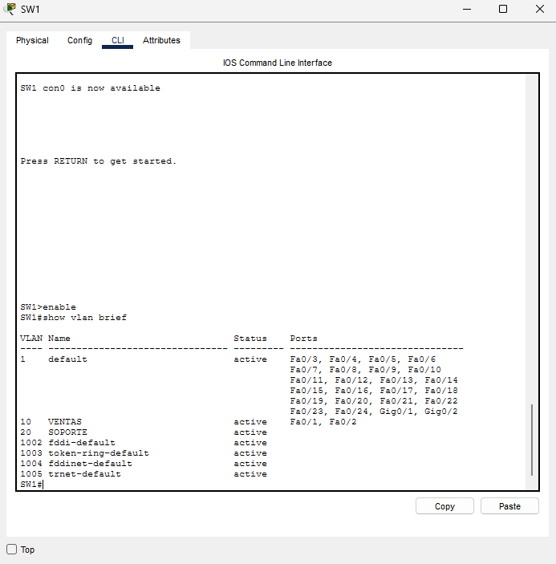
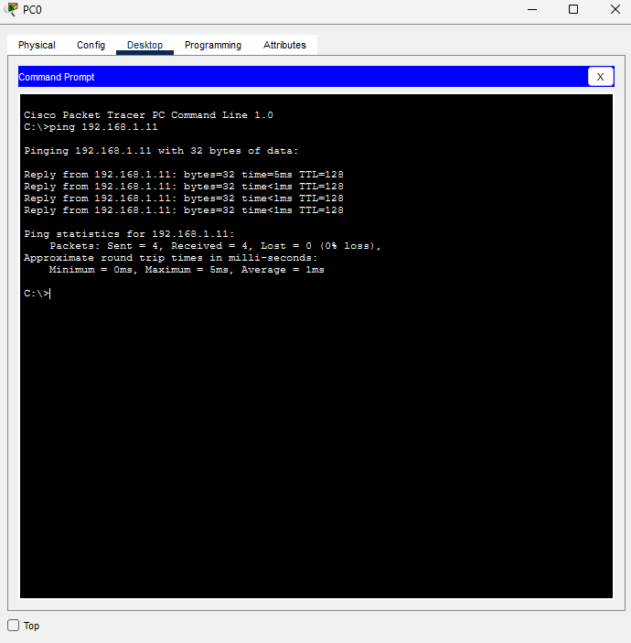
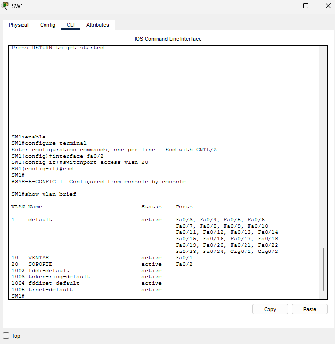
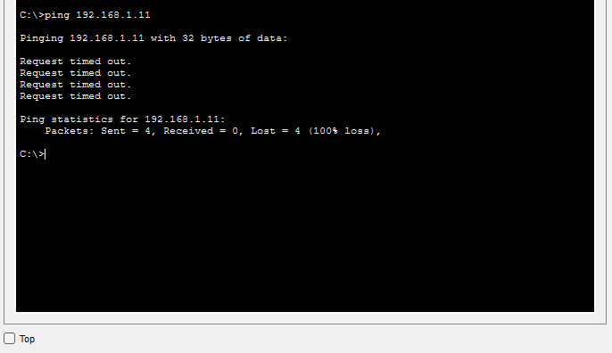

# Práctica 01: VLANs en un switch Cisco 2960

## Objetivo

Comprobar que una VLAN es un dominio de broadcast separado: dos PCs en la misma subred IP no se comunican si están en VLANs distintas.

## Topología

- 1 switch Cisco 2960 (SW1)
- PC0 conectada a Fa0/1
- PC1 conectada a Fa0/2
- Red: 192.168.1.0/24 (máscara 255.255.255.0)
  - PC0: 192.168.1.10
  - PC1: 192.168.1.11

## Configuración

Se crearon dos VLANs y se asignó un puerto de acceso a cada una:

```
vlan 10
 name VENTAS
vlan 20
 name SOPORTE
interface fa0/1
 switchport mode access
 switchport access vlan 10
interface fa0/2
 switchport mode access
 switchport access vlan 20
```

## Pruebas y resultados

### Escenario A: PC0 y PC1 en la misma VLAN (VLAN 10)

Ambos puertos en VENTAS: el ping responde.




### Escenario B: PC0 en VLAN 10 y PC1 en VLAN 20

Cada puerto en una VLAN distinta: el ping falla, aunque las dos PCs tienen IPs de la misma subred.




| Escenario | Resultado |
|---|---|
| PC0 en VLAN 10, PC1 en VLAN 20 | El ping falla |
| PC0 y PC1 en VLAN 10 | El ping responde |

## Qué aprendí

- Los puertos del switch arrancan en la VLAN 1 (default).
- Con VLANs distintas ni siquiera pasa el ARP, porque el broadcast queda confinado a la VLAN de cada puerto.
- Para que VLANs distintas se comuniquen hace falta ruteo entre VLANs (próxima práctica).

## Archivos

- `fase1-01-vlans.pkt`: archivo de Packet Tracer
