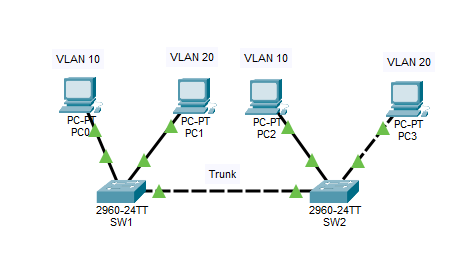
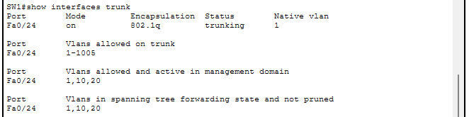
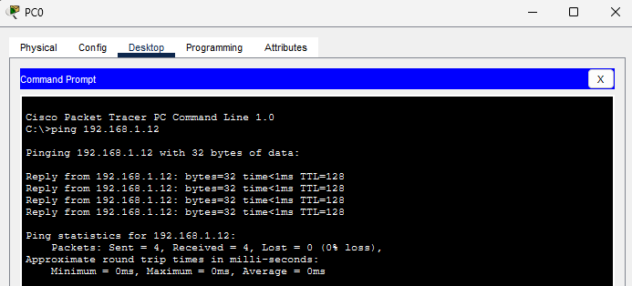
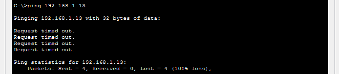

# Práctica 02 - Trunking entre dos switches (802.1Q)

Segunda práctica de la Fase 1 del laboratorio de redes. Se extienden las VLANs de la práctica anterior a un segundo switch mediante un enlace trunk, manteniendo el aislamiento entre VLANs.

## Objetivo

- Conectar dos switches con un puerto trunk.
- Transportar las VLANs 10 y 20 por un único enlace.
- Verificar que los equipos de la misma VLAN se comunican a través de ambos switches y que las VLANs distintas siguen aisladas.

## Herramientas

- Cisco Packet Tracer
- 2 switches Cisco 2960 (SW1 y SW2)
- 4 PCs

## Topología



| Equipo | Puerto | Conectado a |
|---|---|---|
| PC0 | Fa0/1 | SW1 Fa0/1 |
| PC1 | Fa0/2 | SW1 Fa0/2 |
| PC2 | Fa0/1 | SW2 Fa0/1 |
| PC3 | Fa0/2 | SW2 Fa0/2 |
| SW1 | Fa0/24 | SW2 Fa0/24 (trunk) |

## Direccionamiento

Red 192.168.1.0/24 (máscara 255.255.255.0).

| Equipo | IP | Switch / Puerto | VLAN |
|---|---|---|---|
| PC0 | 192.168.1.10 | SW1 Fa0/1 | 10 (VENTAS) |
| PC1 | 192.168.1.11 | SW1 Fa0/2 | 20 (SOPORTE) |
| PC2 | 192.168.1.12 | SW2 Fa0/1 | 10 (VENTAS) |
| PC3 | 192.168.1.13 | SW2 Fa0/2 | 20 (SOPORTE) |

## Configuración

### VLANs en SW2

SW1 ya tenía las VLANs creadas de la práctica anterior. En SW2 se crearon igual:

```
enable
configure terminal
hostname SW2
vlan 10
name VENTAS
exit
vlan 20
name SOPORTE
exit
interface fastEthernet 0/1
switchport mode access
switchport access vlan 10
exit
interface fastEthernet 0/2
switchport mode access
switchport access vlan 20
exit
end
```

### Trunk (en SW1 y en SW2)

```
enable
configure terminal
interface fastEthernet 0/24
switchport mode trunk
end
```

El 2960 de Packet Tracer solo soporta 802.1Q, por eso no hace falta indicar la encapsulación.

## Verificación

```
show vlan brief
show interfaces trunk
```



En `show interfaces trunk` el puerto Fa0/24 figura en modo `on`, encapsulación `802.1q`, estado `trunking`, con native VLAN 1 y las VLANs 1, 10 y 20 permitidas.

## Pruebas de conectividad

| Desde | Hacia | Resultado esperado | Resultado obtenido |
|---|---|---|---|
| PC0 (VLAN 10) | PC2 (VLAN 10) | Responde | Responde |
| PC1 (VLAN 20) | PC3 (VLAN 20) | Responde | Responde |
| PC0 (VLAN 10) | PC3 (VLAN 20) | Falla | Falla |
| PC1 (VLAN 20) | PC2 (VLAN 10) | Falla | Falla |

Ping exitoso entre equipos de la misma VLAN, a través de los dos switches:



Ping fallando entre VLANs distintas:



El primer ping puede perder un paquete mientras se resuelve el ARP y los switches aprenden las MACs; es normal.

## Conceptos aprendidos

- Un puerto **trunk** transporta el tráfico de varias VLANs por un mismo cable.
- **802.1Q** etiqueta cada trama con el número de VLAN para que el otro switch sepa a cuál pertenece.
- La **native VLAN** (por defecto la 1) viaja sin etiquetar por el trunk.
- Sin trunk, las VLANs no se extienden entre switches: dos equipos en la misma VLAN pero en switches distintos no se ven.
- Que haya un trunk no rompe el aislamiento: VLANs distintas siguen sin comunicarse hasta que haya un dispositivo de capa 3.

## Archivos

- `02-trunking.pkt`: archivo de Packet Tracer con la práctica completa.
- `Capturas/`: imágenes usadas en este README.

## Próximo paso

DHCP en un router.
